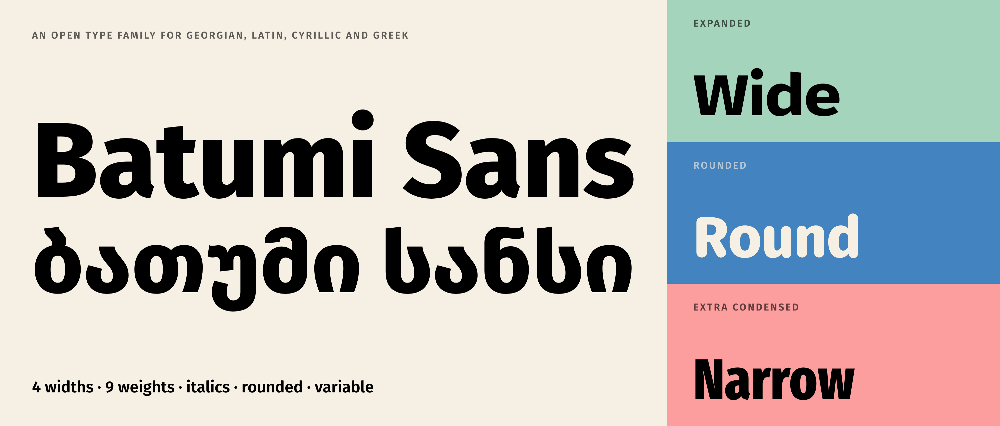
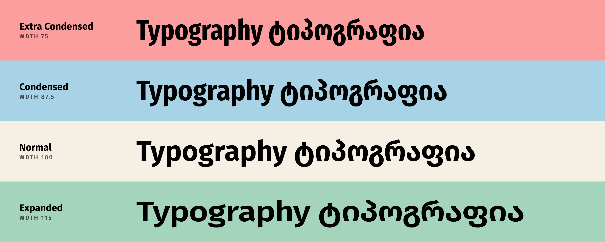
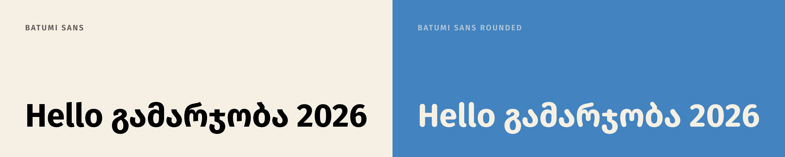
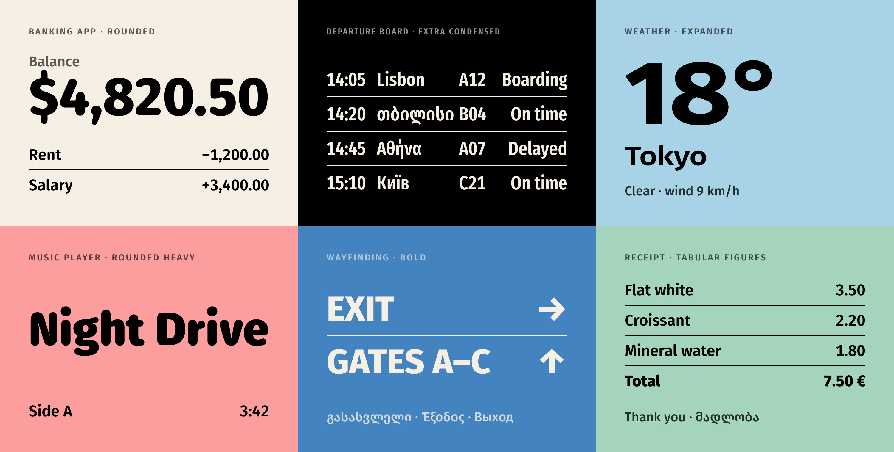
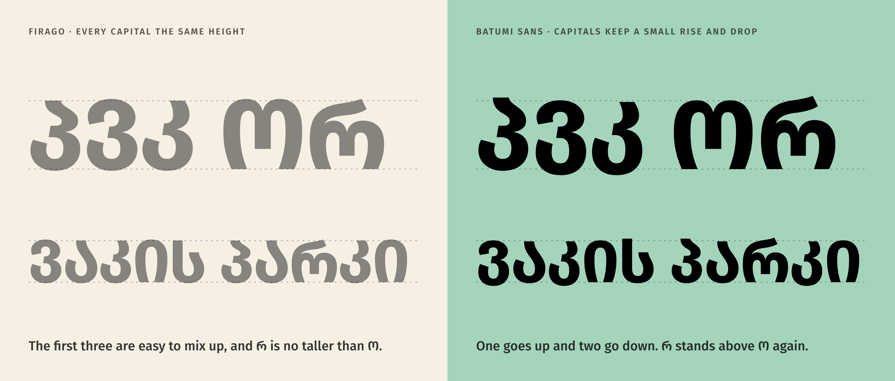
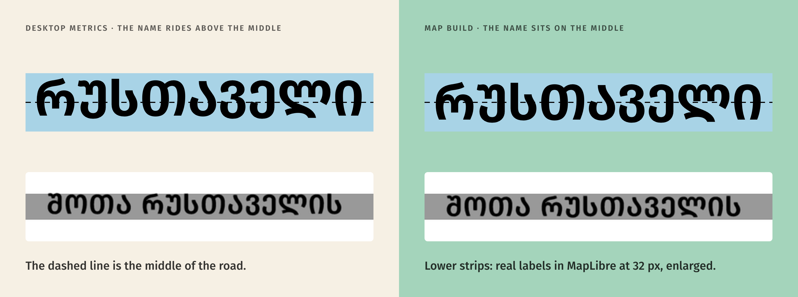
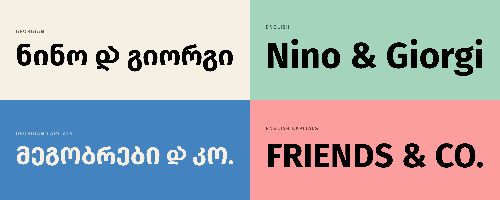

# Batumi Sans

A free, open-source pan-European type family, built on FiraGO and Fira Sans. It has four widths, nine weights, true italics, a rounded companion and variable fonts. It supports [632 languages](docs/LANGUAGES.md) in Georgian, Latin, Cyrillic and Greek, among them the national language of every European state except Armenian, which we plan to add soon. It also keeps the Arabic, Hebrew, Devanagari and Thai that FiraGO already had.



## Is this what you were looking for?

- **A wide Fira Sans.** Fira Sans comes in normal, Condensed and Compressed, and nothing wider. Batumi Sans Expanded is about 15% wider than regular Fira Sans, in every weight and italic, for Latin, Cyrillic, Greek and Georgian.
- **A rounded Fira Sans.** Batumi Sans Rounded has round stroke ends in every width, weight and italic.
- **A rounded sans that has Georgian.** Batumi Sans Rounded is the same kind of design as DIN Rounded, VAG Rounded, Nunito or M PLUS Rounded: a normal sans with round stroke ends, usable for text as well as headlines. Nunito and M PLUS Rounded have no Georgian. In November 2026, three of the roughly 1,960 families on Google Fonts supported Georgian, and none of the three was rounded.
- **A condensed FiraGO.** FiraGO has one width. Batumi Sans Condensed and Extra Condensed pair the Latin of Fira Sans Condensed and Compressed with Georgian narrowed to match.
- **A variable FiraGO.** Weight, width and slant are continuous axes.
- **A Georgian font for maps.** There is a separate build with metrics tuned for MapLibre and Mapbox labels.







Batumi Sans is a separate project from Fira. "Fira" is a reserved font name of its authors, which is why this family has its own name, and they have not reviewed or endorsed it.

## What it adds to FiraGO

- **Three more widths and a rounded version**, for every script, drawn so that stems keep their weight when letters get narrower or wider.
- **Mtavruli with height cues.** Georgian capitals keep a small part of the rise and drop that tells letters apart in lowercase, so Პ, Კ and Ვ stop looking alike in all-caps labels.
- **A Georgian ampersand.** Type `&` in Georgian text and you get a sign made from დ and ა. The word და and the Latin `&` are left alone.
- **Asomtavruli and Nuskhuri**, adapted from Noto Sans Georgian, so all Georgian scripts are covered.
- **More Latin for place names**: the line-below letters used to romanize Arabic, Persian and Hebrew, the prime marks for coordinates, and the diacritics used in Kartvelian linguistics.



The reasoning behind each of these is in [docs/DESIGN.md](docs/DESIGN.md). The ampersand has its own page, including a request to Unicode to encode it: [docs/GEORGIAN_AMPERSAND.md](docs/GEORGIAN_AMPERSAND.md).

## Get the fonts

Download from the [latest release](https://github.com/Borbalo/batumi-sans/releases/latest):

| You want to | Take |
|---|---|
| Use it on a website | `BatumiSans-Web.zip` |
| Install it for Figma, Adobe apps, macOS, Windows or Linux | `BatumiSans-Variable.zip`, or `BatumiSans-Static-Desktop.zip` (144 OTF and 144 TTF) |
| Ship it in an Android app | `BatumiSans-Android.zip` |
| Install it on an iPhone or iPad | `BatumiSans-iOS.mobileconfig` (12 styles) |
| Label a MapLibre or Mapbox map | `BatumiSans-Static-MapLibre.zip` |

Checksums are in `SHA256SUMS.txt`, next to the downloads. The four Google Fonts variable fonts are also in this repository, in `fonts/variable/`.

## Use it

### Web

```html
<link rel="stylesheet" href="batumi-sans-web.css">
<style>
  body  { font-family: 'Batumi Sans', sans-serif; }
  .tag  { font-family: 'Batumi Sans Rounded', sans-serif; font-weight: 700; font-stretch: 87.5%; }
</style>
```

The stylesheet splits the variable font by script, the way Google Fonts does, so a page downloads only the scripts it uses. Georgian is about 160 KB and basic Latin about 170 KB. Weight runs from 100 to 900 and width from 75% to 115%.

### Widths

| Family name | `wdth` axis and `font-stretch` | Real width, Regular |
|---|---|---|
| Batumi Sans Extra Condensed | 75 | about 84% |
| Batumi Sans Condensed | 87.5 | about 91% |
| Batumi Sans | 100 | 100% |
| Batumi Sans Expanded | 115 | about 115% |

The two narrow axis values are labels, not measurements: `font-stretch: 75%` gives you a face that is 84% as wide as normal. Every family also exists as Rounded.

### Weights

Thin 100, ExtraLight 200, Light 300, Regular 400, Medium 500, SemiBold 600, Bold 700, ExtraBold 800, Heavy 900. Each has an italic. The Google Fonts edition calls 900 "Black".

### Design apps

`BatumiSans-Variable.zip` has two folders. Install the four files in `creative-3axis`, which have weight, width and slant axes. The upright and italic files are linked, so the italic button and ⌘I work.

The four files in `google-fonts-2axis` are the same design with weight and width only. Install one set, not both, because both use the same family names.

### Android

Copy `res/font/` from the Android zip into your app and use `@font/batumi_sans` or `@font/batumi_sans_rounded`. For Compose, add `BatumiSansCompose.kt` and use `BatumiSans` or `BatumiSansRounded`.

### iPhone and iPad

Open the `.mobileconfig` file on the device and install the profile in Settings. It adds Regular, Italic, Medium, Bold, Bold Italic and Heavy, in both the standard and the rounded design.

### Maps

A street name on a map should sit on the middle of its road. MapLibre does not look at the letters to place it. It uses one number stored in the font, the ascender, and with the number that suits documents a Georgian street name rides above the middle of the road.

The map build is the same font with that one number changed, so the name sits on the middle. That is all "centred" means here.



Use the map build for generating glyph PBFs and nowhere else, because the changed number also changes line spacing.

### The Georgian ampersand



In Georgian text it appears by itself when you type `&`, and English text keeps its own. To force it anywhere, turn on `ss07` (lowercase form) or `ss08` (all-caps form):

```css
.logo { font-feature-settings: "ss07"; }
```

## Build

```bash
python3 -m venv .venv && ./.venv/bin/pip install -r requirements.txt
./.venv/bin/python scripts/build_superfamily.py --subfamilies all --styles all
./.venv/bin/python scripts/build_maplibre_fonts.py
./.venv/bin/python scripts/build_variable_fonts.py --both-editions --add-expansion49-to-vfs
./.venv/bin/python scripts/build_web_subsets.py --source-mode 2axis
./.venv/bin/python scripts/build_releases.py
```

The build needs three font families that are not stored in this repository:

- [FiraGO](https://github.com/bBoxType/FiraGO) OTF files, expected in `~/Library/Fonts` (change this with `--src-dir`).
- [Fira Sans](https://github.com/bBoxType/FiraSans) Condensed and Compressed OTF files, expected in `reference_fonts/firasans_condensed/` and `reference_fonts/firasans_extracondensed/` (change the folder with `--ref-dir`).
- [Noto Sans Georgian](https://github.com/notofonts/georgian) TTF files, expected in `~/Library/Fonts` or `reference_fonts/noto-georgian/`.

The fonts are written to `dist/` and the release files to `releases/`. Checks are in `qa/`.

## Status

Version 1.100. Release notes are in [CHANGELOG.md](CHANGELOG.md). Batumi Sans is not on Google Fonts yet. A submission is being prepared, and the files for it are in [google-fonts/](google-fonts/README.md).

## License and credits

Batumi Sans is licensed under the [SIL Open Font License 1.1](OFL.txt), with no reserved font name. You can use it in personal and commercial work, embed it, modify it and redistribute it.

Batumi Sans was designed for [Borbalo](https://borbalo.ge) by Koba Jgenti. It is derived from:

- **FiraGO**, © 2012–2018 bBox Type GmbH and HERE Europe B.V. Akaki Razmadze co-designed its Georgian.
- **Fira Sans**, Fira Sans Condensed and Fira Sans Compressed, © 2012–2018 The Mozilla Foundation, Telefónica S.A., Carrois Corporate GbR and bBox Type GmbH.
- **Noto Sans Georgian**, © 2019 Google LLC, for Asomtavruli and Nuskhuri.

The full list of authors and contributors is in [AUTHORS.txt](AUTHORS.txt) and [CONTRIBUTORS.txt](CONTRIBUTORS.txt).

### Crediting Batumi Sans

The licence does not require a credit when you use the font. If you use it, we would appreciate one:

> Batumi Sans, designed for Borbalo by Koba Jgenti.

Where a company name is needed:

> Batumi Sans, developed for Borbalo by KJ Group LLC.

Anyone who redistributes or modifies the font must keep the copyright notice in `OFL.txt` and in the font files. That part is required by the licence.
