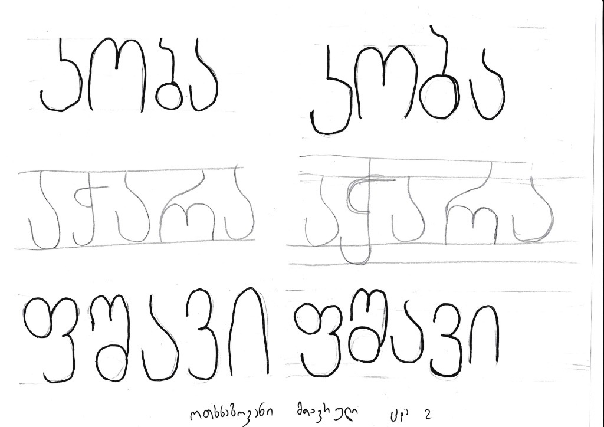
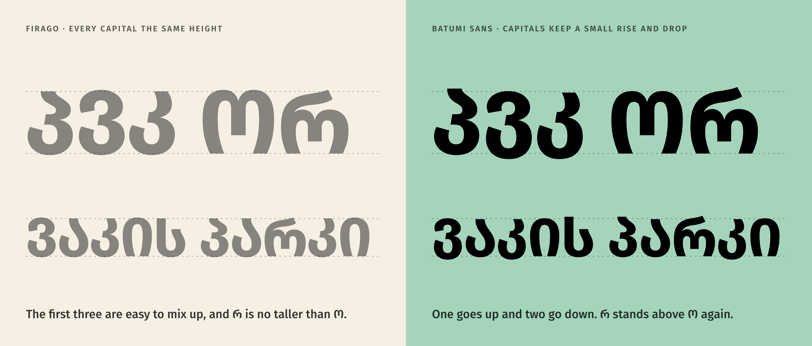
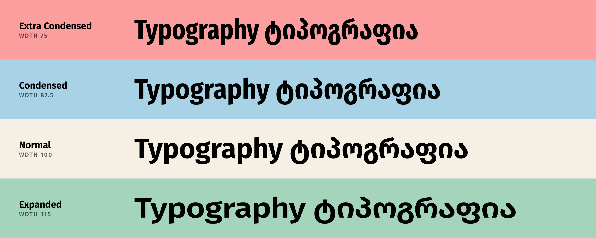
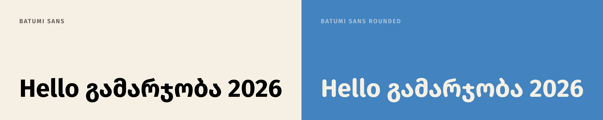
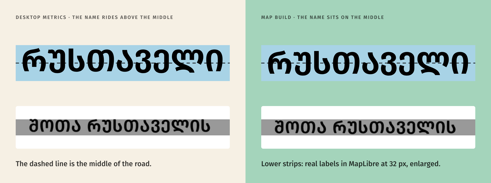
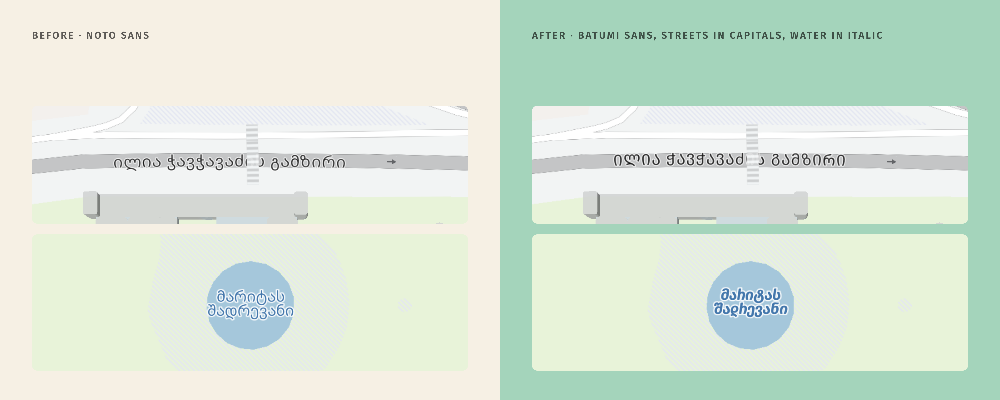
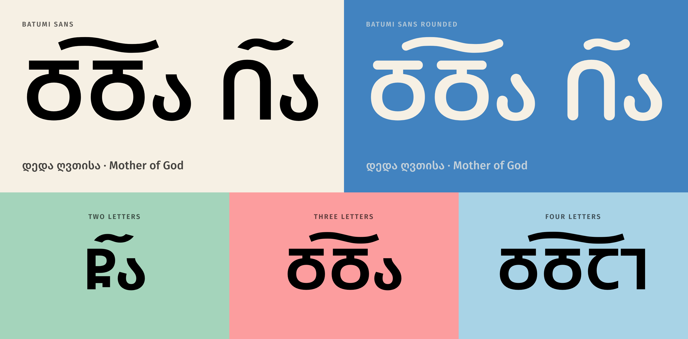

# Design notes

What Batumi Sans changes in FiraGO, and why. The README says what the family is and how to install it. This page is for people who want to know how the decisions were made.

Measurements are in font units (1000 per em) and were taken from the Regular weight of the built fonts unless a line says otherwise.

## Starting point

FiraGO is a good open Georgian sans with one width. Fira Sans, its Latin parent, has Condensed and Compressed cuts, but they have no Georgian. Neither family has a wide cut, a rounded cut or a variable font.

Batumi Sans was made for the Borbalo app and its maps, and both hit those gaps:

- Map labels need narrow type, and the map is in Georgian.
- Rounded type is everywhere in interfaces, signage and packaging, and we could not find an open rounded family that covers Georgian.
- Street names and labels are set in Mtavruli, and at small sizes several Mtavruli letters look alike.

Everything below follows from one of these.

## Mtavruli with height cues

### The problem

Lowercase Georgian (Mkhedruli) sits on four lines. Letters rise above the middle zone, drop below it, or stay inside it, and that is a large part of how they are told apart: პ rises, კ and ვ drop.

Mtavruli, the all-caps form that Unicode encoded in 2018, is normally drawn between two lines. Every letter is stretched or squeezed to the same height. Three things go wrong:

- Პ, Კ and Ვ end up with nearly the same outline.
- Რ, which is taller than ო in lowercase, comes down to the same height as Ო.
- Ჲ, a small letter in lowercase, is inflated to full height.

Koba Jgenti sketched an alternative in June 2021: the same capitals, with some of the rise and drop put back.

### The objections

Two Georgian type designers who saw the idea disagreed with it, for reasons worth repeating in full:

1. **Almost every letter moves.** In English capitals only J and Q ever leave the line, and they are rare. In Georgian about 27 of the 33 letters rise or drop in lowercase. Give them all back their full height and you have enlarged lowercase with a ragged edge.
2. **Mtavruli is used where space is tight.** Georgian does not capitalize sentences, so capitals appear on signs, buttons, map labels and two-line headlines. A flat band is what keeps lines from colliding there.

Both points are right. The question became how small a cue could be and still do its job.

### The test

We built ten versions of the Mtavruli, from flat to a rise and drop of 120 units, and set them side by side: next to Latin capitals, as pairs of look-alike letters, and in two-line headlines at a line height of 1.05.

What we saw:

- **Large cues (78 and 120 units) look like big lowercase.** The objection was correct.
- **Cues on only the 13 most confusable letters look like mistakes.** In ᲔᲕ, a flat Ე beside a dropped Ვ reads as a baseline error. It has to be all the letters or none.
- **60 units is too tall next to Latin capitals.**
- **About 45 units is enough to separate the look-alikes and small enough to keep the band.**

### What shipped

Every Mtavruli letter that rises or drops in lowercase does so by 44.5 units, which is 6.5% of the cap height and about a fifth of the distance it travels in lowercase. The whole Mtavruli set is also 14 units shorter than the Latin capitals, so the rising letters do not stand far above an adjacent Latin word.

| | Top | Bottom |
|---|---:|---:|
| Latin H | 689 | 0 |
| Ა | 675 | −14 |
| Პ | 720 | −14 |
| Ვ | 687 | −58 |
| Კ | 675 | −58 |
| Ო | 687 | 0 |
| Რ | 734 | 0 |

Პ now goes up and Ვ and Კ go down, so the three no longer share an outline, and Რ stands 47 units above Ო. Of the 46 Mtavruli characters, 21 rise and 22 drop.

## The Georgian ampersand

Typing `&` in Georgian text produces a sign made from დ and ა, the two letters of the Georgian word for "and". It has its own page: [GEORGIAN_AMPERSAND.md](GEORGIAN_AMPERSAND.md).

## Widths

### Why not just squeeze

Scaling a letter to 83% of its width makes its vertical strokes 17% thinner and leaves its horizontal strokes alone. The result looks weak and uneven. Widening does the opposite and makes the verticals heavy.

### What we do

Each letter is treated as stems plus the space between them. The space is scaled and the stems keep nearly their full weight. Three things are adjusted on top of that:

- **Heavier weights narrow less.** A Heavy letter has less white space to give up, so its body narrows less and its side spacing tightens more.
- **Letters are grouped by structure.** Wide letters with several arches (ლ, დ, ღ, ო, რ) narrow more than average in light weights. Letters with tight counters (უ, ჭ, ჟ) narrow less. A floor stops any counter from closing up.
- **Italics are straightened first.** Squeezing a slanted letter changes its angle. Italic outlines are un-slanted, adjusted and slanted again, so the angle stays at 8° in every width. FiraGO's Georgian italic also uses different, single-arch shapes for დ, ლ, რ and ტ, and those are not treated as multi-arch letters.

### Where the proportions come from

The Latin, Cyrillic and Greek of the two narrow widths are taken from Fira Sans Condensed and Fira Sans Compressed. FiraGO's Georgian has the same stem weights as its Latin, so the Georgian is narrowed by the same ratios and the two scripts keep the same colour on a line. How much each individual Georgian letter gives up follows the pattern in Noto Sans Georgian's condensed widths.

Nothing in Fira is wide, so Expanded is new for every script.

### How wide each one really is

| Family | `wdth` value | Regular | Heavy |
|---|---:|---:|---:|
| Extra Condensed | 75 | 84% | 88% |
| Condensed | 87.5 | 91% | 93% |
| Normal | 100 | 100% | 100% |
| Expanded | 115 | 115% | 113% |

Percentages are the average advance width of Georgian lowercase compared with the normal width.

The `wdth` values of the narrow widths do not match their real widths. This is a known inconsistency: the OpenType specification says `wdth` should be the percentage of normal width.

## Rounded

### What kind of rounded

"Rounded" covers two different things.

- **Rounded terminals.** A normal sans keeps its skeleton, proportions and spacing, and only the ends of its strokes and its outer corners are rounded. DIN Rounded, VAG Rounded, Gotham Rounded and Arial Rounded are of this kind, and so are Nunito, M PLUS Rounded and Varela Round among open fonts. These work at text sizes, which is why they are used for interface labels, signage, packaging, children's books and brands that want to sound friendly.
- **Soft all over.** The strokes swell and the insides of the joins are rounded too. These are display faces for a few large words.

Batumi Sans Rounded is the first kind. It is Batumi Sans with round stroke ends, with the same metrics and spacing, so one can replace the other without the layout moving.

### Why it was needed

The well-known open rounded families do not cover Georgian. In November 2026 Google Fonts listed about 1,960 families. Three of them supported Georgian (Noto Sans Georgian, Noto Serif Georgian and Google Sans), and none of those is rounded. Nunito, M PLUS Rounded, Varela Round, Quicksand, Comfortaa and Fredoka have no Georgian. As far as we could find, setting Georgian in a rounded style meant buying a commercial font or pairing a different design with the rounded Latin.

### The rules

Batumi Sans Rounded is generated from the standard design by rule:

- **Stroke ends become half circles.**
- **Outer corners are rounded**, with a radius of about half the stem width.
- **Inner corners stay sharp.** Rounding the inside of a join fills the counter and makes heavy weights blur at small sizes.
- **Round ends overshoot slightly**, so they do not look shorter than flat ones.

The curves are a little fuller than true circle arcs. Circle arcs drawn with Bézier curves use a handle length of 0.5523 of the radius, and we use 0.580. An exact half circle looks pinched where it meets the straight side of a stroke, and the fuller curve removes that.

Some shapes needed their own treatment. The clearest example is the heavy Mtavruli Ბ, where a full round cap swallowed the short stroke at the top and left a stub. In Bold and heavier weights its neck is lifted and its top is narrowed before rounding.

## Italic

The italics are FiraGO's, at 8°, with its cursive Georgian forms. The variable fonts also have a slant axis from 0° to 12°.

## Two kinds of variable font

There are two sets of variable fonts because two audiences need different things.

- **Three axes (weight, width, slant)**, in `dist/variable/`, for design tools and self-hosted websites.
- **Two axes (width, weight)**, as separate upright and italic files, in `google-fonts/`. Google Fonts does not accept an italic file that also has a slant axis, and it limits file size. These also call the 900 weight "Black", as Google's naming rules require.

The 144 static fonts exist because some software still needs them. Map glyph generators want one named face per style, and in our tests an iOS configuration profile would not install the variable fonts.

## The map build

MapLibre places a label on a line using the font's ascender value, not the visible height of the letters. With FiraGO's value of 935, Mtavruli street names in our maps sat about 2 pixels above the road centreline.

The map build raises that value to 1040 and changes nothing else. In our tests, at a glyph size of 24 pixels, Mtavruli then sits on the centreline and Latin capitals sit half a pixel above it.

The value was chosen for capitals, because our street labels are in Mtavruli. Lowercase Georgian sits about 1.5 pixels below the centreline with this build. That is closer than Noto Sans, and less centred than lowercase was before the change. If your map labels are lowercase, test both builds.

Desktop and web fonts keep 935, because changing it there would change line spacing in every document.

This is the Borbalo map before and after the change of typeface. Street names moved to Mtavruli and water names to italic at the same time.

## Symbols

The arrow and key symbols (⇦ ⇧ ⇨ ⇩ ⇪ ⏎ ⌫ and the Mac modifier keys) were redrawn. Hollow arrows tend to close up in heavy and narrow styles. These are built from a centreline with a fixed stroke, so the inside stays open in Extra Condensed Heavy. They have sharp corners in the standard design and round ones in Rounded.

## Repairs to what we inherited

Building four widths and a variable font exposed problems in the FiraGO sources that do not show in normal use:

- Some outlines run in the wrong direction (8 upright glyphs and 49 italic).
- In 31 cases the same glyph starts its outline at a different point in two neighbouring weights, which makes interpolation twist the shape. The counter of თ collapsed in Expanded Bold Italic because of this.
- ჟ and რ touch in Bold and Heavy italics, because ჟ was put in a kerning class with round-sided letters.

All three are fixed in the build. They would be worth reporting to FiraGO.

## Old abbreviations

Georgian frescoes, icons and manuscripts shorten words to save space and draw a mark over the shortened form, the ქარაგმა. დედა ღვთისა, "Mother of God", is written as a group of three letters and a group of two, each under one mark. წმინდა, "saint", is an Asomtavruli Ⴜ and a Mkhedruli ა.

Batumi Sans can set these. It has every Georgian script, so Asomtavruli and Mkhedruli letters can stand in one word, and one mark stretches over two, three or four letters. It works in Rounded as well.

To type one, put the combining double tilde (U+0360) between the letters. The three-letter group above is Ⴃ, U+0360, Ⴃ, U+0360, ა. The font joins the marks into a single one.

## What we did not change

- **Arabic, Hebrew, Devanagari and Thai** are carried over from FiraGO.
- **Asomtavruli and Nuskhuri** are adapted from Noto Sans Georgian, matched to Batumi Sans in weight, width and height.
- **The Latin, Cyrillic and Greek at normal width** are FiraGO's, with characters added.
