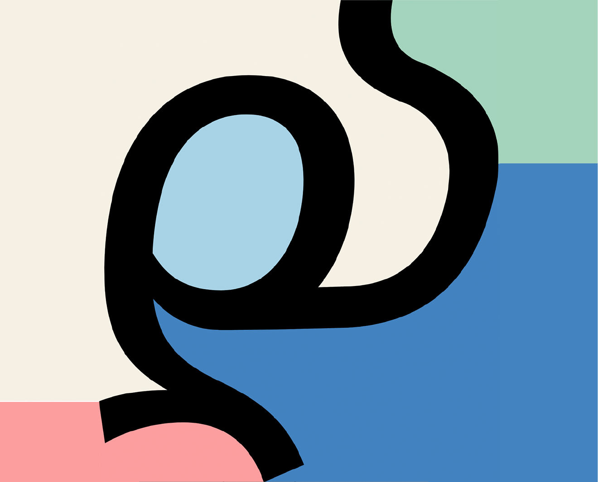
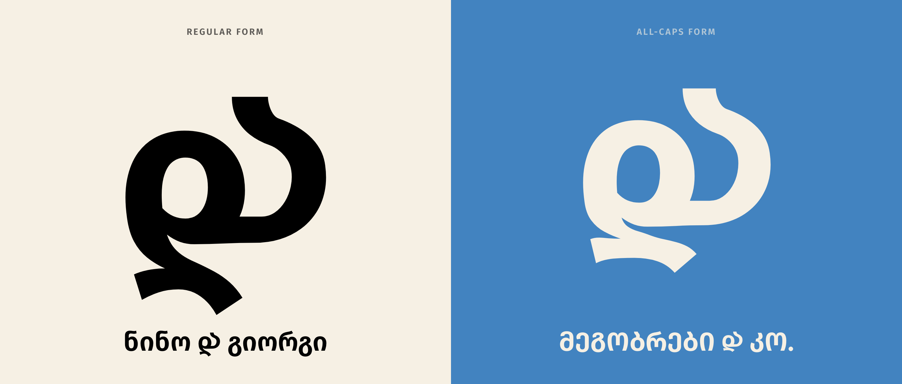
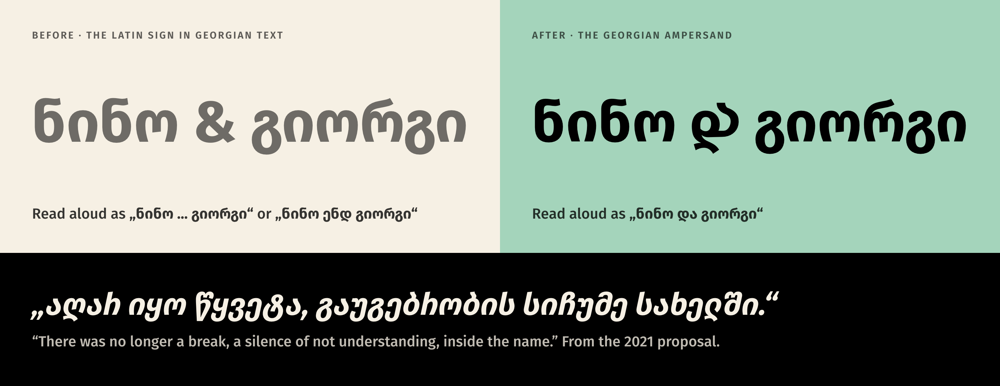
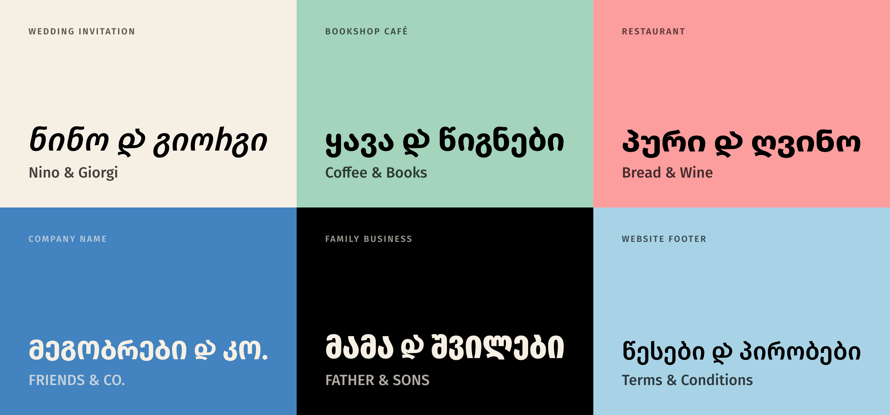
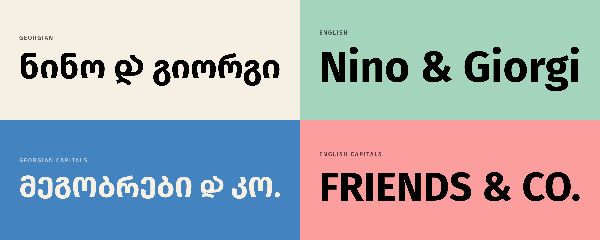
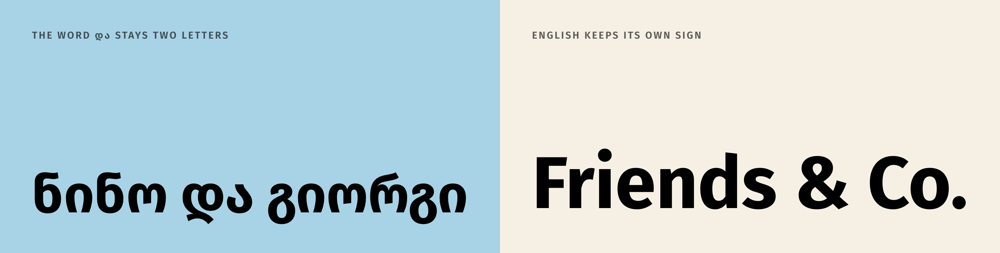

# The Georgian ampersand



Georgian has a long tradition of writing its word for "and", და, as one joined shape. The Georgian ampersand makes that tradition a single sign. It goes where Latin text uses &.



Batumi Sans includes it in every style. This page explains why it exists, how it works in the font, and why we are asking Unicode to encode it.

## Why

The ampersand is a word. & is the Latin *et*, "and", written so often that its two letters fused into one shape about two thousand years ago. People who read Latin-script languages grew up with it. It is on their keyboards and in their brand names: Dolce & Gabbana, Tiffany & Co., H&M.

In Georgian text it carries nothing. Koba Jgenti's 2021 proposal, which started this work, described what Georgian readers do when they meet it: they skip it and say „დოლჩე გაბანა“, or they read it in English and say „ეიჩ ენდ ემ“. The sign fails at the one thing it is for.



The proposal described what changed when the Georgian sign went in: „აღარ იყო წყვეტა, გაუგებრობის სიჩუმე სახელში“. There was no longer a break, a silence of not understanding, inside the name.

Georgian has what it needs to make its own:

- **The word has always been written joined.** Georgian handwriting moved from Asomtavruli to Nuskhuri to Mkhedruli largely to write faster and with fewer pen lifts, and დ and ა are among the letters Mkhedruli scribes joined most, above all when they form the word და. Writing "and" as one shape is as old a habit in Georgian as it is in Latin.
- **The word is two letters.** და joins as naturally as *et* did. A three-letter word like English *and* or a one-letter word like Russian *и* could not do this.
- **Brands already need it.** When a name with & is written in Georgian, companies reach for a joined და, each in its own way, because there is no standard sign.

## What the sign has to do

Koba Jgenti proposed the sign in 2021 and set out what it has to do:

- It is made from Mkhedruli დ and ა.
- You read დ first and ა second, left to right, and can still see და in it.
- It looks like one symbol, not two letters standing close, and does not imitate the Latin sign.
- It is no larger than two joined letters, and large enough to stand where & stands.
- It is easy to write by hand.
- It has two forms: a regular form on four lines, like the letter ქ, and an all-caps form on two lines for Mtavruli.

In 2022 the Presidential Administration of Georgia adopted these requirements as written.

The sign in Batumi Sans is Koba Jgenti's original drawing, and it meets every one of them:

- **Regular form.** Drops below the baseline as დ does and rises to about capital height.
- **All-caps form.** Fits Mtavruli and Asomtavruli text.

## Where it goes

Anywhere Georgian text would otherwise borrow the Latin sign: names on an invitation, a shop sign, a company name, a line in a website footer.



## How it works in Batumi Sans

You type &. The font looks at the text around it. Georgian text gets the Georgian sign, and English keeps its own.



| You type | You get |
|---|---|
| ნინო & გიორგი | Georgian ampersand, regular form |
| ᲛᲔᲒᲝᲑᲠᲔᲑᲘ & ᲙᲝ. | Georgian ampersand, all-caps form |
| Georgian text with the `case` feature on | Georgian ampersand, all-caps form |
| Nuskhuri or Asomtavruli text | The regular or the all-caps form |
| Friends & Co. | The normal Latin & |
| Greek or Cyrillic text | The normal Latin & |
| ნინო და გიორგი | The letters დ and ა, unchanged |
| & by itself, or in a logo | Latin &, unless you turn on `ss07` (regular form) or `ss08` (all-caps form) |

This page is not set in Batumi Sans, so the table shows a plain & in every row. The pictures are rendered from the font in a browser and show the real result.

The word და is never replaced. The sign is something you choose by typing &.



```css
.logo      { font-feature-settings: "ss07"; }  /* the regular form, anywhere */
.logo-caps { font-feature-settings: "ss08"; }  /* the all-caps form, anywhere */
```

Two things to know:

- **Lines that mix Georgian and Latin.** Which ampersand appears depends on how the app splits the line into scripts. Use `ss07` or `ss08` to choose it yourself.
- **Software that does not apply OpenType features.** Some map renderers and canvas libraries draw characters one at a time. For those, the two forms are also at Private Use codepoints U+E0A0 and U+E0A1. These work only with Batumi Sans.

## A request to Unicode

We ask the Unicode Consortium to encode the Georgian ampersand as two characters: the regular form and the all-caps form. A formal proposal is in the works, and this section sets out the case it will make.

### The problem is real

For most Georgian readers & carries no meaning. They leave it out or say it in English. When a name with & is written out in Georgian letters, the English word goes in with it: Head & Shoulders becomes ჰედ ენდ შოლდერსი. Georgian has its own word, და, and no sign for it.

This would be reason enough even if nobody had tried to fix it.

### The demand is real

The need already shows on the street. When a name with & is put into Georgian, the symbol has to be translated too.

- **H&M.** Its first shop in Georgia opened in Tbilisi in 2017 with the name in Georgian letters. Between ჰ and მ, where the & stands, it put the traditional ligature of და, with the ა set on top of the დ. Georgian writing has used that ligature for hundreds of years, and H&M's press office in Georgia called it a device of old Georgian calligraphy ([Fortuna, 6 November 2017](https://fortuna.ge/h-da-m-haundemi-tu-haedamani-diakh-am-brendma-pativi-sca-sakhelmwifo-enas/)).
- **GPC.** The pharmacy chain writes its slogan აფთიაქი და მეტი, "pharmacy and more", with one looped stroke in place of the word ([gpcoffers.ge](https://gpcoffers.ge/ka)).
- **Type foundries.** [type.today](https://www.instagram.com/p/DCcMaujiEFD/) in 2024 and [TypeType](https://www.instagram.com/p/DZFgK-sih8n/) in 2026 both published the H&M sign and called it the Georgian ampersand.

### One sign, many drawings

These are the same sign in three drawings: the traditional stacked ligature at H&M, a looped stroke at GPC, and the form in Batumi Sans, joined side by side. Every character has many drawings. What is missing is the character itself.

Today each of these exists only as a picture. None can be typed, searched or set in another font, so the sign stays inside logos. One Unicode character would give all of them a standard that any font can carry and anyone can type.

### Why a font is not enough

In Batumi Sans the Georgian sign is drawn in place of a Latin ampersand. The text underneath still says &, and in any other font it turns back into one.

The sign is also not the word და. The word stays two letters, and the sign is chosen in its place, the way & is chosen in place of "and". Text needs a way to tell the sign from the word and from the Latin ampersand.

### The family it would join

Unicode already encodes signs that stand for the word "and" in other scripts:

- & (U+0026), Latin *et*
- ⁊ (U+204A, capital U+2E52), the Tironian *et*, still used for Irish *agus*
- ϗ (U+03D7, capital U+03CF), Greek *και*
- ⳤ (U+2CE4), Coptic *ⲕⲁⲓ*

Each began as a short word that scribes shortened to save space and time. Georgian scribes joined და for the same reason.

The Greek sign is the closest case. It was [proposed in 1998](https://www.unicode.org/L2/L1998/98210-n1743.pdf) on the observation that many shops in Athens preferred it to the Latin & on their signs. Shops in Georgia are doing the same thing now. We ask for the Georgian ampersand to join this family.

## Credits

The Georgian ampersand was proposed and drawn by Koba Jgenti in 2021, and the design was deposited with Sakpatenti in January 2022 (certificate 8533). It is part of Batumi Sans and is released with it under the SIL Open Font License.

The cover at the top of this page is from the 2021 proposal, and the colours of the pictures are taken from it.
